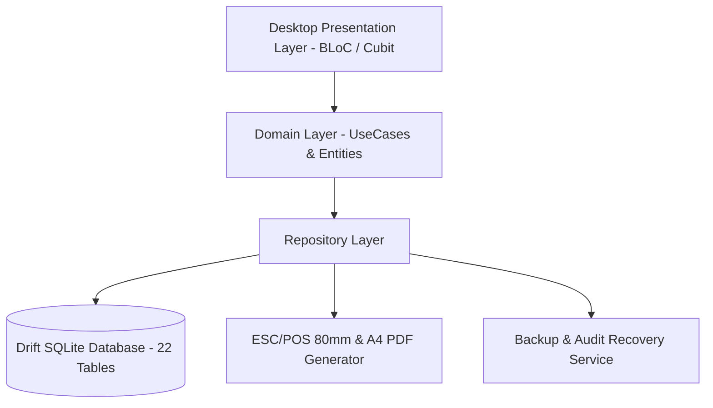

# Sales Manager ERP — Offline-First Desktop Management System

[](https://flutter.dev)
[](https://dart.dev)
[-4169E1?logo=sqlite)](https://drift.simonbinder.eu)
[-brightgreen?logo=checkmarx)](tests)
[](analysis_options.yaml)
[]()

An enterprise-grade, **Offline-First Windows Desktop ERP system** architected for retail, wholesale, and inventory operations. Designed to operate completely independent of internet connectivity with absolute financial precision, atomic ledger transactions, and hardware receipt printing.

---

## 🌟 Key Engineering Highlights

### 1. Offline-First Architecture & Drift (SQLite)
* **22 Normalized Relational Tables:** Complete domain modeling for Products, Inventory Batches, Suppliers, Customers, Sales Invoices, Purchase Orders, Double-Entry Ledgers, Cashbox Transactions, and Expenses.
* **Atomic Transactions:** Every business action (sale, return, payment, inventory adjustment) executes inside atomic database transactions, preventing partial writes and ensuring mathematical ledger consistency.
* **Zero-Leakage DAOs:** Database operations encapsulated in dedicated Data Access Objects (DAOs) using Drift's type-safe query builder.

### 2. High-Precision Financial Engine
* **Integer Arithmetic (Piastres):** Eliminates floating-point rounding errors by representing all monetary values as integers (e.g., $100.50 \rightarrow 10,050$ piastres).
* **Precise Decimal Quantities:** Utilizes `Decimal` types for unit and fractional inventory measurements.
* **Negative Stock Prevention:** Hard constraints at the database and state levels strictly prevent sales exceeding physical on-hand inventory.

### 3. Rigorous Quality & 100% Test Coverage
* **247+ Automated Tests:** Comprehensive test coverage covering DAOs, state transitions, repository failure handling, and UI widgets.
* **Zero Analyzer Warnings:** Strictly enforced via `analysis_options.yaml` (`flutter analyze` returns zero errors and zero warnings).

### 4. Hardware & Desktop Integration
* **Multi-Format Receipt Printing:** Native integration for **ESC/POS 80mm thermal receipt printers** and standard **A4 PDF** invoice generation.
* **Command Palette (Universal Search):** Keyboard-driven navigation via `Ctrl + K` / `Ctrl + F` for rapid product, customer, and transaction discovery.
* **Automated Backup & Recovery:** Built-in manual and automated SQLite database snapshot generator with an immutable system audit trail (`audit_logs`).

---

## 🏛️ System Architecture & Data Flow



---

## 📊 Modules & Capabilities

| Module | Description | Key Capabilities |
|---|---|---|
| **Sales (POS)** | Point-of-sale checkout | Multi-item invoices, discount handling, immediate cashbox update, customer balance update. |
| **Purchases** | Supplier order management | Cost tracking, automatic weighted average unit cost calculation, supplier ledger crediting. |
| **Ledgers** | Dual customer & supplier accounts | Full transaction history, statement of account export (PDF/CSV), debt aging alerts. |
| **Cashbox** | Daily treasury & expenses | Daily cash inflow/outflow reconciliation, categorized expense management. |
| **Reports** | 7 analytical dashboards | Sales performance, COGS & gross margin, inventory valuation, cash flow, CSV export. |
| **Inventory** | Stock tracking & settlements | Real-time stock levels, stock movement history, mandatory-reason settlement adjustments. |

---

## 🧪 Running Automated Tests

To run the complete test suite:

```bash
flutter test
```

To run static analysis:

```bash
flutter analyze
```

---

## 💻 Tech Stack

* **Framework:** Flutter Desktop (Windows)
* **Language:** Dart
* **Database:** Drift (SQLite) with FFI bindings
* **State Management:** BLoC / Cubit
* **Dependency Injection:** GetIt
* **Routing:** GoRouter
* **Printing & PDF:** `pdf`, `printing`, ESC/POS command formatting
