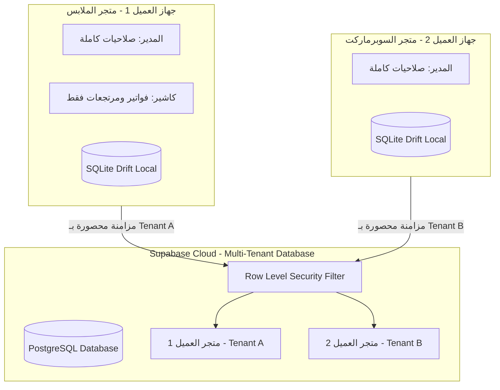

# 📋 تقرير تنظيف البيانات السحابية وخطة نظام المستخدمين والمتاجر (Multi-Tenant & RBAC)

---

## أولاً: نتيجة تفريغ بيانات الباك إند (Supabase Cloud Wipe)

تم بنجاح حذف وتصفير كافة البيانات التشغيلية والتجريبية من قاعدة بيانات **Supabase Cloud** لتبدأ تجربة العميل على قاعدة بيانات فارغة ونظيفة تماماً (`0 سجلات`)، مع **الحفاظ الصارم** على جدول التحديثات الهوائية (`app_versions`) وملفات التثبيت المرفوعة.

### جدول حالة الجداول بعد التصفير:

| اسم الجدول في Supabase | طبيعة البيانات | الحالة بعد الحذف |
| :--- | :--- | :---: |
| `products` | المنتجات والأصناف | **0 (فارغ)** |
| `customers` | العملاء وأرصدتهم | **0 (فارغ)** |
| `suppliers` | الموردين وأرصدتهم | **0 (فارغ)** |
| `sales` | فواتير المبيعات | **0 (فارغ)** |
| `sale_items` | بنود فواتير المبيعات | **0 (فارغ)** |
| `purchases` | فواتير المشتريات | **0 (فارغ)** |
| `purchase_items` | بنود فواتير المشتريات | **0 (فارغ)** |
| `customer_payments` | سندات قبض العملاء | **0 (فارغ)** |
| `supplier_payments` | سندات صرف الموردين | **0 (فارغ)** |
| `cashbox_transactions` | حركات الخزينة والنقدية | **0 (فارغ)** |
| `expenses` | المصروفات العامة | **0 (فارغ)** |
| `inventory_movements` | الحركات المخزنية | **0 (فارغ)** |
| `stock_adjustments` | تسويات الجرد المخزني | **0 (فارغ)** |
| `customer_ledger_entries` | كشف حساب العملاء | **0 (فارغ)** |
| `supplier_ledger_entries` | كشف حساب الموردين | **0 (فارغ)** |
| `returns_customer` | مرتجعات العملاء | **0 (فارغ)** |
| `return_customer_items` | بنود مرتجعات العملاء | **0 (فارغ)** |
| `returns_supplier` | مرتجعات الموردين | **0 (فارغ)** |
| `return_supplier_items` | بنود مرتجعات الموردين | **0 (فارغ)** |
| `audit_log` | سجل العمليات والرقابة | **0 (فارغ)** |
| `sync_batches` | دفعات المزامنة السابقة | **0 (فارغ)** |
| `app_versions` | **إصدارات التحديث الهوائي (OTA)** | **محفوظ ومحمي (3 إصدارات)** |

> [!NOTE]
> عند تثبيت العميل للنسخة على جهازه، سيتم إنشاء ملف قاعدة بيانات محلية جديد تماماً، وعند اتصاله بالسحابة سيجد السحابة نظيفة ولن تُحمّل له أي بيانات قديمة.

---

## ثانياً: خطة نظام المستخدمين والمتاجر المتعددة (Multi-Tenancy & RBAC Plan)

### المشكلة الحالية:
حالياً، يعمل التطبيق بنظام المتجر الفردي المسطح (`Single Tenant`). جميع الأجهزة التي تتصل بنفس رابط Supabase تتشارك نفس الجداول دون عزل (`tenant_id`) ودون نظام تسجيل دخول (`Auth & Roles`).

### الهدف المستقبلي:
1. **عزل المتاجر (Multi-Tenancy):** كل عميل/متجر يمتلك `tenant_id` مستقل، وبيانات المتجر "أ" معزولة تماماً ومستحيل أن تظهر للمتجر "ب" على السحابة عبر سياسات الأمان الصارمة (Row Level Security - RLS).
2. **إدارة صلاحيات الموظفين (RBAC):** داخل المتجر الواحد، هناك مدير، وكاشير، ومحاسب، ولكل دور صلاحيات محددة.
3. **العمل بدون إنترنت (Offline-First Auth):** إمكانية تسجيل دخول الموظفين حتى في حال انقطاع الإنترنت التام.



---

### مراحل التنفيذ المقترحة:

### المرحلة 1: عزل المتاجر في قاعدة البيانات السحابية (Multi-Tenancy & RLS)
1. **إنشاء جدول المتاجر/الشركات (`organizations` أو `tenants`):**
   - يحتوي على: `id (UUID)`, `name`, `license_key`, `subscription_status`, `created_at`.
2. **إضافة عمود `tenant_id` لجميع الجداول:**
   - كل جدول (`products`, `sales`, `customers`, `expenses`, ...) يُضاف له:
     ```sql
     ALTER TABLE public.products ADD COLUMN tenant_id UUID NOT NULL REFERENCES public.tenants(id);
     ```
3. **تفعيل سياسات الأمان الصارمة (Supabase RLS):**
   - استبدال السياسة الحالية (`Allow all`) بسياسات تعتمد على هوية المستخدم أو رمز المتجر:
     ```sql
     CREATE POLICY "Tenant Isolation Policy" ON public.products
     FOR ALL USING (tenant_id = auth.jwt() ->> 'tenant_id');
     ```

---

### المرحلة 2: هيكل المستخدمين المحلي والسحابي (Hybrid Offline Auth)
نظراً لأن التطبيق يعمل في نقاط البيع (POS) ويجب ألا يتوقف أبداً عند انقطاع الإنترنت:
1. **جدول المستخدمين المحلي (`users` في Drift):**
   - `id`: المعرف الفريد.
   - `username`: اسم الدخول (أو رقم الجوال).
   - `password_hash`: كلمة المرور المشفرة محلياً بخوارزمية (PBKDF2 مع Salt).
   - `pin_code_hash`: كود سريع من 4 أرقام لتسهيل تبديل الكاشير بسرعة في نقطة البيع.
   - `role`: الدور (`admin`, `cashier`, `accountant`, `stock_manager`).
   - `tenant_id`: معرف المتجر التابع له.
   - `is_active`: حالة الحساب.
2. **دعم تسجيل الدخول المزدوج (Hybrid Flow):**
   - **عند توفر الإنترنت:** التحقق من السحابة وتحديث الجلسة وتزامن التراخيص.
   - **عند انقطاع الإنترنت:** التحقق الفوري محلياً عبر قاعدة بيانات SQLite دون أي انتظار أو تعطيل لحركة البيع.

---

### المرحلة 3: مصفوفة الصلاحيات والأدوار (Roles & Permissions Matrix)

| الصلاحية / الشاشة | مدير النظام (Admin) | الكاشير (Cashier) | المحاسب (Accountant) | أمين المخزن (Storekeeper) |
| :--- | :---: | :---: | :---: | :---: |
| **إنشاء فاتورة بيع وطباعتها** | ✅ | ✅ | ❌ | ❌ |
| **عمل مرتجع عميل** | ✅ | ✅ | ❌ | ❌ |
| **رؤية أسعار الشراء وتكلفة البضاعة** | ✅ | ❌ | ✅ | ❌ |
| **رؤية تقارير الأرباح والخسائر** | ✅ | ❌ | ✅ | ❌ |
| **تعديل أسعار المنتجات أو حذفها** | ✅ | ❌ | ❌ | ❌ |
| **إجراء جرد وتعديل الكميات** | ✅ | ❌ | ❌ | ✅ |
| **تسجيل فواتير مشتريات من الموردين** | ✅ | ❌ | ✅ | ✅ |
| **الصرف من الخزينة وتسجيل المصروفات** | ✅ | ❌ | ✅ | ❌ |
| **إدارة المستخدمين والصلاحيات** | ✅ | ❌ | ❌ | ❌ |
| **عرض وتفريغ سجل الرقابة (Audit Log)** | ✅ | ❌ | ❌ | ❌ |

---

### المرحلة 4: حماية الواجهات (UI Guards & Session State)
1. **`AuthCubit` و `SessionManager`:**
   - تخزين المستخدم المسجل حالياً في الذاكرة وفي التخزين الآمن المشفر (`flutter_secure_storage`).
2. **مكون التحقق من الصلاحيات (`PermissionGuard`):**
   - إخفاء الأزرار والبطاقات الحساسة تلقائياً إذا كان المستخدم لا يمتلك الصلاحية (مثل بطاقة "صافي الربح" أو تبويب "الخزينة والمصروفات").
   - قفل الشاشات غير المصرح بها ومنع الدخول إليها.
3. **التبديل السريع للمستخدم (Quick Switch):**
   - زر سريع في أعلى الشاشة يتيح للكاشير كتابة رمز PIN المكون من 4 أرقام لتسليم الوردية للكاشير الآخر في ثوانٍ معدودة.

---

### المرحلة 5: تدفق الإعداد لأول مرة (Store Setup & Onboarding Wizard)
عند فتح التطبيق لأول مرة على جهاز العميل:
1. يظهر معالج بسيط:
   - إدخال اسم المتجر ورقم الهاتف ونوع النشاط.
   - إنشاء الحساب الرئيسي (اسم مستخدم المدير وكلمة المرور).
2. يقوم التطبيق بإنشاء `tenant_id` محلي وسحابي وربطه برخصة البرنامج تلقائياً.
